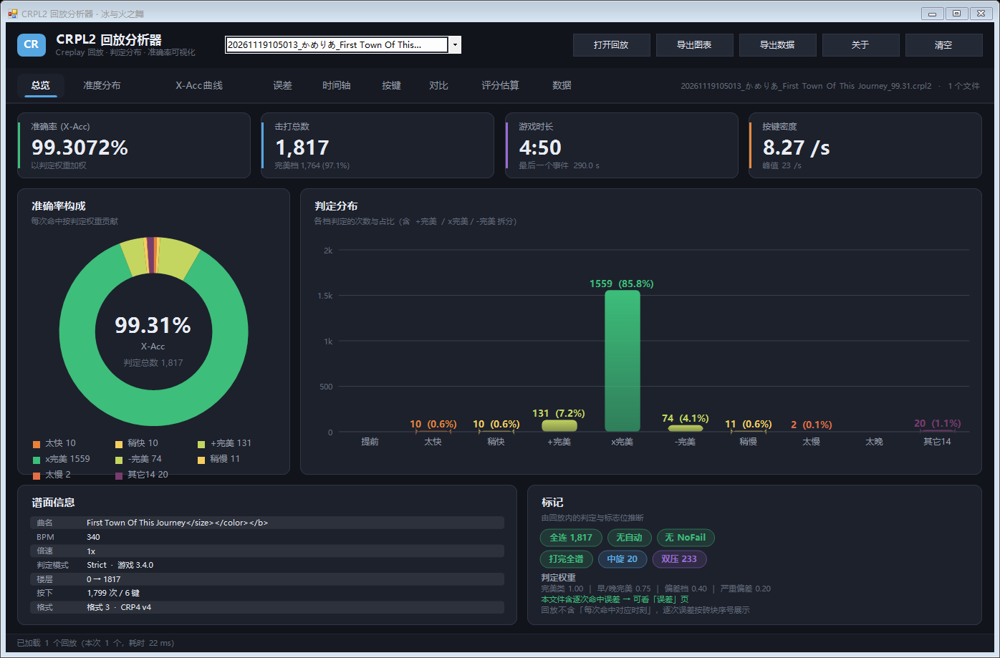
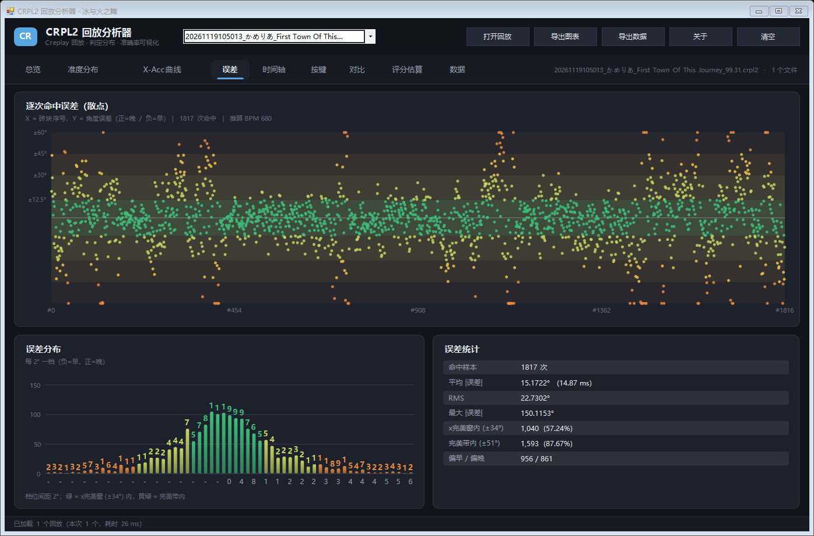

# CRPL2 回放分析器


**CRPL2 Replay Analyzer** — a single-file Windows tool that decrypts and parses *A Dance of Fire and Ice* (ADOFAI) [Creplay](https://github.com/SleepingCui/crpl2tools) replays (`.crpl2`) and visualizes judgments, accuracy composition, per-hit timing error and a live X-Acc curve. No Python / Node / .NET SDK required — it runs on the .NET Framework 4.8 that ships with Windows 10/11.

用于分析 **ADOFAI（冰与火之舞）Creplay 模组回放（`.crpl2`）** 的 Windows 桌面工具。
单文件 exe，双击即用，不需要 Python / Node / .NET SDK。

| 版本 | 主要内容 |
| --- | --- |
| v1.0 | CRP2(v2) 解析、判定分布、准确率、时间轴、按键 |
| v1.1 | 支持 CRP4(v3) / ADOFAI 3.4.0 XPerfect；新增「误差」页 |
| v1.2 | 新增「X-Acc 曲线」页：由逐次角度误差反推每击判定，画实时 X-Acc |
| **v1.2.1** | **修复鼠标扫过导航条时的闪烁（自绘面板改为双缓冲 + 局部重绘）** |

**支持的格式：**

| 容器 | 内部版本 | 录制环境 | 逐次误差 | 实时 X-Acc |
| --- | --- | --- | --- | --- |
| `CRP2` (v2) | formatVersion 2 | Creplay ≤ 2.11 / ADOFAI 3.3.x | ✗ | ✗ |
| `CRP4` (v4) | formatVersion 3 | Creplay 2.17 / ADOFAI 3.4.0+ | ✓ | ✓ |



---

## 下载

- **直接用**：到 [Releases](https://github.com/InbottlesN235/Crpl2Analyzer/releases/latest) 下载 `Crpl2Analyzer.exe`（约 113 KB，单文件，无需安装）。
- **自己编译**：仓库内执行 `powershell -ExecutionPolicy Bypass -File build.ps1`，产物在仓库根目录。

首次运行 Windows 可能提示「已保护你的电脑」——点「更多信息 → 仍要运行」即可（未做代码签名）。

## 一、运行

| 方式 | 操作 |
| --- | --- |
| 双击 | `Crpl2Analyzer.exe` |
| 带文件启动 | 把 `.crpl2` 拖到 exe 图标上，或 `Crpl2Analyzer.exe "xxx.crpl2"` |
| 程序内打开 | 右上「打开回放」（可多选，`Ctrl+O`） |
| 拖放 | 直接把文件拖进窗口 |
| 多文件 | 支持同时加载新旧格式，用顶部下拉框切换，「对比」页横向比较 |

导出：**导出图表**（当前页 PNG）、**导出数据**（JSON / 按键 CSV / 逐次误差 CSV / 判定 CSV）。
逐次误差 CSV 含 `judgment, weight, xacc_after_hit` 三列，即每一击的判定与打出这一击之后的 X-Acc。

---

## 二、八个页面

### 1. 总览
准确率、击打数、时长、按键密度；环形图 + 判定分布；谱面信息与「全连 / 无自动 / 无 NoFail / 打完全谱 / 中旋 / 双压」标记。

### 2. 准度分布
- **判定分布**：v2 显示 8 档，v3 自动显示 `完美- / X完美 / 完美+` 拆分。
- **放大视图**：自动剔除出现最多的那一档，让 1% 的细节可见。
- **判定环形图**、**早/晚平衡**、**准度损失分解**。


### 3. X-Acc 曲线 ★（仅 formatVersion 3）
**每一击之后**的 X-Acc 折线：

- 绿线 **累计 X-Acc** = 前 k 击权重之和 ÷ k（就是游戏里那个 X-Acc 的运行值）。
- 蓝线 **最近 N 击滑动**，用来看局部手感漂移。
- 背景浅色柱是该击的**误差绝对值**（独立量纲，只用来给曲线提供结构，不参与 Y 轴）。
- 下方给出**分段 X-Acc**（整局切 8 段）与**反推校验**：把逐击分类结果和文件里的 `JudgmentList`、`percentXacc` 对照。


> 示例文件是满分 167 击，所以曲线是平的 —— 这不是 bug：`22×1.00 + 144×1.00 + 1×1.00 = 167`，X-Acc 全程 1.000000。柱状背景仍然能看出哪几击贴着 X完美 边界。

### 4. 误差（仅 formatVersion 3）
- **散点图**：X = 砖块序号，Y = 角度误差（正=晚 / 负=早），叠加 ±12.5°/±30°/±45°/±60° 判定窗色带。
- **误差分布直方图**、**误差统计**（平均 |误差|、RMS、最大误差、X完美占比、偏早/偏晚）。



### 5. 时间轴
每秒按键密度（原始 + 3 秒滑动平均）、最长无输入区间、30 秒分段表、累计按键曲线。

### 6. 按键
键位使用排行、按键间隔直方图、双压统计、键位迁移热图。

### 7. 对比
多回放准确率对比 + 判定构成堆叠条。

### 8. 数据
容器参数、SHA-256、谱面路径、BPM（缺失时由误差反推）、逐次误差条数、判定明细、录制模组。


---

## 三、实时 X-Acc 是怎么算出来的

回放里没有「每次命中的时刻」，但有**每次命中的角度误差**。于是分三步：

**① 定判定窗**（与 ADOFAI 一致，静态角与时间下限取大者，`bpm` 已含倍速与音高）：

```
Counted = max(60°,  65ms × BPM × 3)
Perfect = max(45°,  30ms × BPM × 3)
Pure    = max(30°,  20ms × BPM × 3)
XPerfect= max(12.5°, 16.67ms × BPM × 3)
```

**② 逐击分类**（角度误差为负=早，正=晚）：

| 条件 | 判定 | 槽位 | X-Acc 权重 |
| --- | --- | --- | --- |
| \|e\| < XPerfect | X完美 | 4 | 1.00 |
| \|e\| < Pure | 完美- / 完美+ | 3 / 5 | 1.00 |
| \|e\| < Perfect | 早完美 / 晚完美 | 2 / 6 | 0.75 |
| \|e\| < Counted | 很过 / 很晚 | 1 / 7 | 0.40 |
| 其它 | 过早 / 过晚 | 0 / 8 | 0.20 |

**③ 累加** `XAcc(k) = Σ权重(1..k) / k`，末值即 `percentXacc`（若用过检查点，文件值还要乘 `0.9875^检查点数`）。

### 精确性验证

示例文件 `20261116222218_OfficialLevel_1-X_100.00.crpl2`：

```
文件 JudgmentList = [0,0,0,22,144,1,0,0,0,0,0,0,0,0,0,0]
反推判定分布     = [0,0,0,22,144,1,0,0,0,0,0,0,0,0,0,0]   ← 逐槽位完全一致
文件 percentXacc  = 1.0000000000
反推最终 X-Acc    = 1.0000000000
```

也就是说：**每击判定是从角度误差里一条不差地还原出来的**，不是按比例猜的。只要 `JudgmentList` 与反推结果对不上（用了检查点、自定义 `marginScale`、或出现了未识别的槽位），「反推校验」卡片会直接标红，曲线只作参考。

---

## 四、已知限制

1. **X 轴是命中序号，不是时间**。回放没有逐击时间戳，本工具不把按键时刻硬套成命中时刻。
2. 旧格式（formatVersion 2）**只有判定汇总**，无法反推每击判定，「X-Acc 曲线」「误差」两页会给出说明而不是空图。
3. v3 判定槽位只观测到 3/4/5 三档有值，14/15 未知；`hitFlags` 的 bit5 语义未定。
4. 若谱面用了逐砖 `marginScale`（非 1.0）、或录到了检查点，分类会偏，校验会提示。
5. 回放绑定 `floor_hash / speed_hash / time_hash`，谱面一改即失效。

---

## 五、源码与构建

```
src/Model.cs       CRP2/CRP4 解密、两种内部版本解析、逐击判定反推、X-Acc 计算、导出
src/Charts.cs      绘图基础件（卡片、柱状、环形、对称、热图、密度、折线、散点、坐标轴取整）
src/Views.cs       八个页面
src/Program.cs     主窗口、导航、拖放、导出、自测/截图模式
build.ps1          用系统自带 csc.exe 编译（无需 SDK、无需联网）
```

```powershell
powershell -ExecutionPolicy Bypass -File build.ps1
```

调试模式（不开窗口，把每一页渲染成 PNG，并在 `selftest.txt` 打印 `xaccValid / xaccFinal / match / derived`）：

```powershell
Crpl2Analyzer.exe --selftest "xxx.crpl2" out_dir
```

---

## 六、验证记录

- `formatVersion 2`：`Cinamoro - Storyteller - 03 Fancy`（2252 击 / 99.1186%）—— 解析与准确率反推逐位一致。
- `formatVersion 3`：`OfficialLevel 1-X`（167 击 / 100% / BPM 150）—— 判定分布、X完美占比、逐击反推、X-Acc 末值四方交叉一致。
- 两个文件都在最终 exe 上跑过 `--selftest`；截图来自真实窗口（`--shot` 建窗后 `DrawToBitmap`）。


---

## 七、许可

[GPL-3.0-or-later](LICENSE) © 2026 [InbottlesN235](https://github.com/InbottlesN235)

本程序是自由软件：你可以依据自由软件基金会发布的 GNU 通用公共许可证（第 3 版或任意更新版本）条款重新分发和/或修改它。
本程序基于「希望有用」的目的分发，但不提供任何担保，甚至不包含适销性或特定用途适用性的默示担保 —— 详见 [LICENSE](LICENSE)。

本工具不包含任何游戏资源，只读取玩家自己录制的回放文件。
格式来源、社区致谢以及本项目通过实测补充的结论见 [CREDITS.md](CREDITS.md)；版本改动见 [CHANGELOG.md](CHANGELOG.md)。
