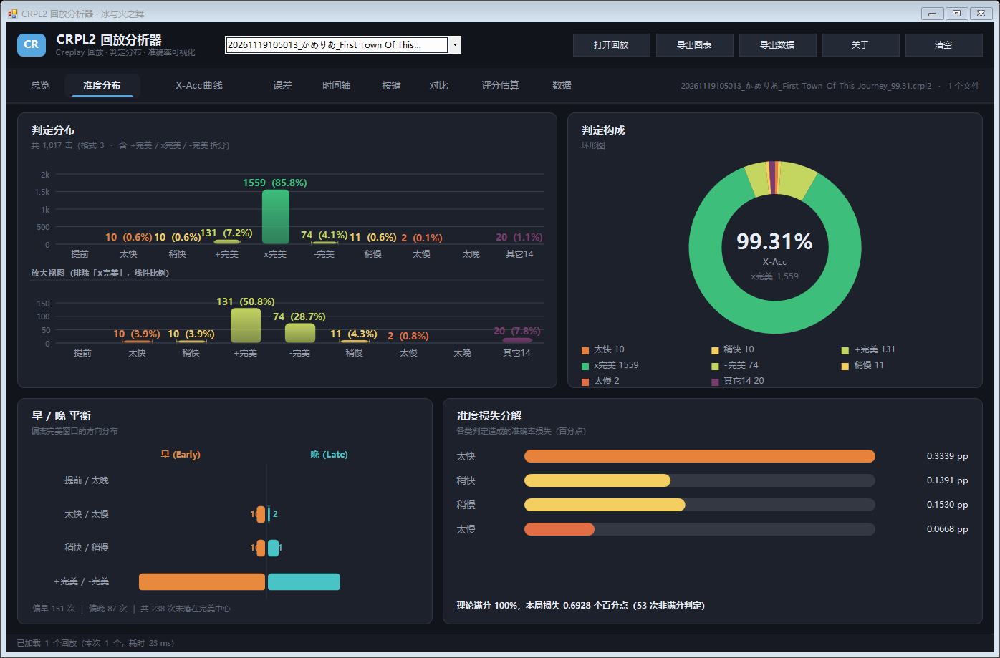
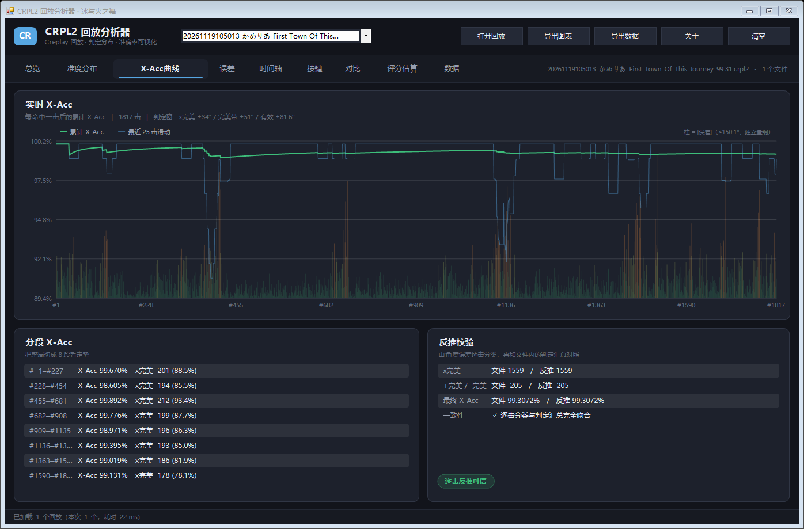
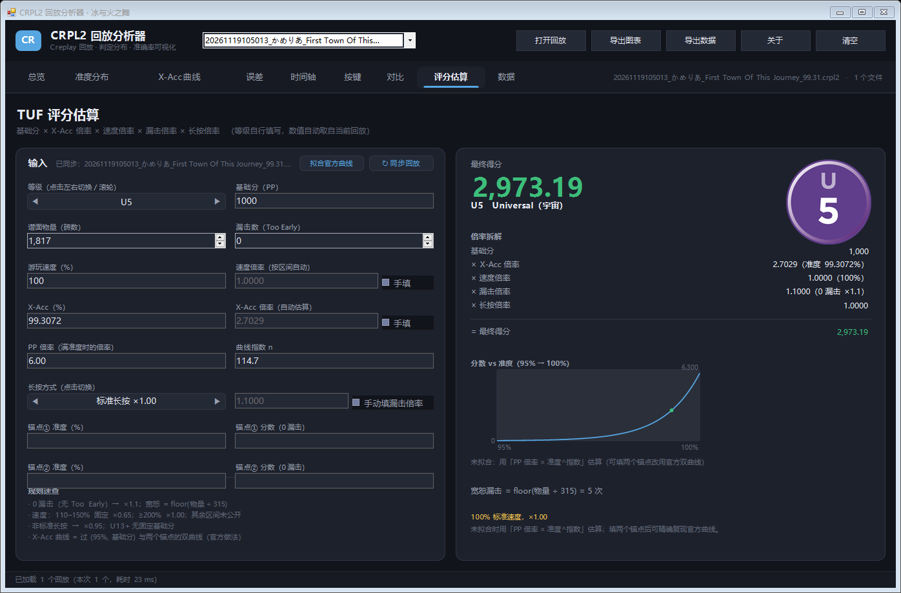
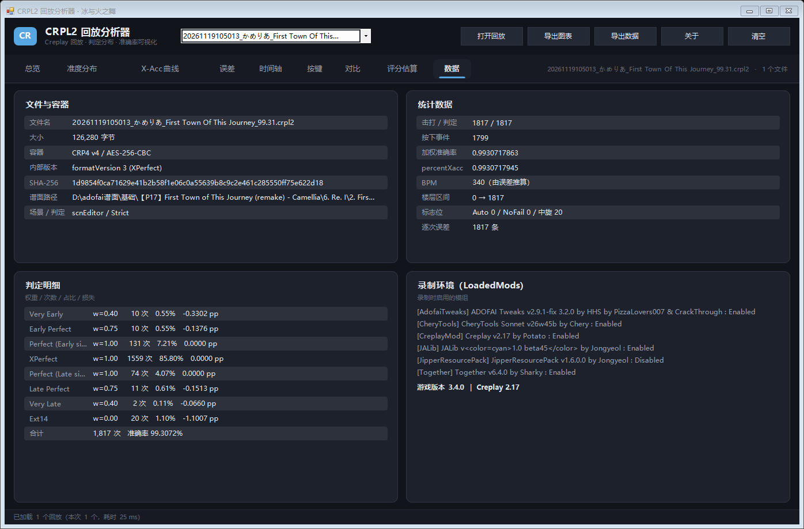
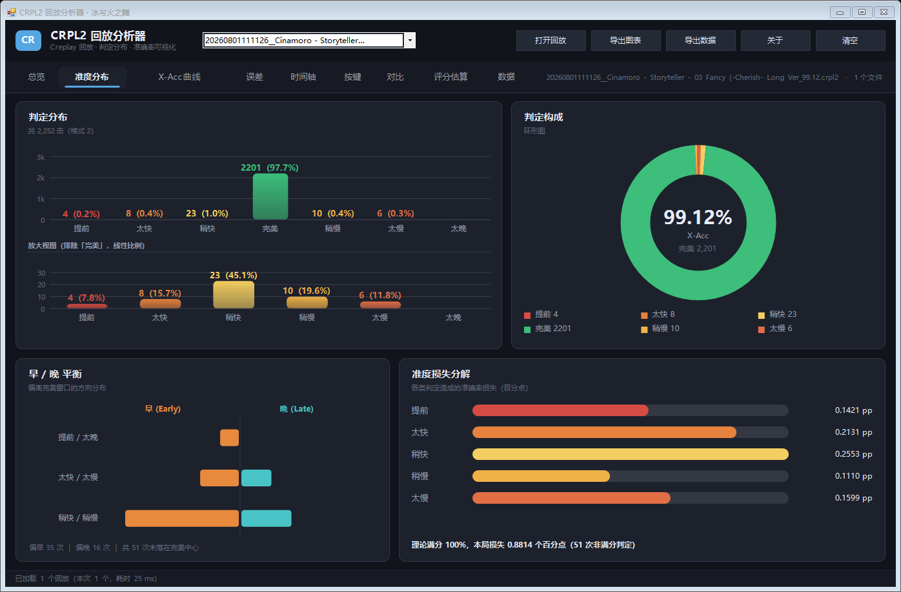

# CRPL2 回放分析器


**CRPL2 Replay Analyzer** — a single-file Windows tool that decrypts and parses *A Dance of Fire and Ice* (ADOFAI) [Creplay](https://github.com/SleepingCui/crpl2tools) replays (`.crpl2`) and visualizes judgments, accuracy composition, per-hit timing error and a live X-Acc curve. No Python / Node / .NET SDK required — it runs on the .NET Framework 4.8 that ships with Windows 10/11.

用于分析 **ADOFAI（冰与火之舞）Creplay 模组回放（`.crpl2`）** 的 Windows 桌面工具。
单文件 exe，双击即用，不需要 Python / Node / .NET SDK。

| 版本 | 主要内容 |
| --- | --- |
| v1.0 | CRP2(v2) 解析、判定分布、准确率、时间轴、按键 |
| v1.1 | 支持 CRP4(v3) / ADOFAI 3.4.0 XPerfect；新增「误差」页 |
| v1.2 | 新增「X-Acc 曲线」页：由逐次角度误差反推每击判定，画实时 X-Acc |
| **v1.2.1** | **修复鼠标扫过导航条时的闪烁（自绘面板改为双缓冲 + 局部重绘）** |

**支持的格式：**

| 容器 | 内部版本 | 录制环境 | 逐次误差 | 实时 X-Acc |
| --- | --- | --- | --- | --- |
| `CRP2` (v2) | formatVersion 2 | Creplay ≤ 2.11 / ADOFAI 3.3.x | ✗ | ✗ |
| `CRP4` (v4) | formatVersion 3 | Creplay 2.17 / ADOFAI 3.4.0+ | ✓ | ✓ |


---

## 下载

- **直接用**：到 [Releases](https://github.com/InbottlesN235/Crpl2Analyzer/releases/latest) 下载 `Crpl2Analyzer.exe`（约 113 KB，单文件，无需安装）。
- **自己编译**：仓库内执行 `powershell -ExecutionPolicy Bypass -File build.ps1`，产物在仓库根目录。

首次运行 Windows 可能提示「已保护你的电脑」——点「更多信息 → 仍要运行」即可（未做代码签名）。

## 一、运行

| 方式 | 操作 |
| --- | --- |
| 双击 | `Crpl2Analyzer.exe` |
| 带文件启动 | 把 `.crpl2` 拖到 exe 图标上，或 `Crpl2Analyzer.exe "xxx.crpl2"` |
| 程序内打开 | 右上「打开回放」（可多选，`Ctrl+O`） |
| 拖放 | 直接把文件拖进窗口 |
| 多文件 | 支持同时加载新旧格式，用顶部下拉框切换，「对比」页横向比较 |

导出：**导出图表**（当前页 PNG）、**导出数据**（JSON / 按键 CSV / 逐次误差 CSV / 判定 CSV）。
逐次误差 CSV 含 `judgment, weight, xacc_after_hit` 三列，即每一击的判定与打出这一击之后的 X-Acc。

---

## 二、九个页面

### 1. 总览
准确率、击打数、时长、按键密度；环形图 + 判定分布；谱面信息与「全连 / 无自动 / 无 NoFail / 打完全谱 / 中旋 / 双压」标记。

### 2. 准度分布
- **判定分布**：v2 显示 7 档 + Miss，v3 额外拆出 ±12.5° 的 `x完美`（命名见下方「判定档位命名」）。
- **放大视图**：自动剔除出现最多的那一档，让 1% 的细节可见。
- **判定环形图**、**早/晚平衡**、**准度损失分解**。



### 3. X-Acc 曲线 ★（仅 formatVersion 3）
**每一击之后**的 X-Acc 折线：

- 绿线 **累计 X-Acc** = 前 k 击权重之和 ÷ k（就是游戏里那个 X-Acc 的运行值）。
- 蓝线 **最近 N 击滑动**，用来看局部手感漂移。
- 背景浅色柱是该击的**误差绝对值**（独立量纲，只用来给曲线提供结构，不参与 Y 轴）。
- 下方给出**分段 X-Acc**（整局切 8 段）与**反推校验**：把逐击分类结果和文件里的 `JudgmentList`、`percentXacc` 对照。



> 示例文件是满分 167 击，所以曲线是平的 —— 这不是 bug：`22×1.00 + 144×1.00 + 1×1.00 = 167`，X-Acc 全程 1.000000。柱状背景仍然能看出哪几击贴着 X完美 边界。

### 4. 误差（仅 formatVersion 3）
- **散点图**：X = 砖块序号，Y = 角度误差（正=晚 / 负=早），叠加 ±12.5°/±30°/±45°/±60° 判定窗色带。
- **误差分布直方图**、**误差统计**（平均 |误差|、RMS、最大误差、X完美占比、偏早/偏晚）。


### 5. 时间轴
每秒按键密度（原始 + 3 秒滑动平均）、最长无输入区间、30 秒分段表、累计按键曲线。

### 6. 按键
键位使用排行、按键间隔直方图、双压统计、键位迁移热图。

### 7. 对比
多回放准确率对比 + 判定构成堆叠条。

### 8. 评分估算 ★
按 **TUF 论坛评分标准** 估算一局通关的最终得分：左边选等级、填物量与漏击，右边实时出分。

- **等级**：点击左右箭头或滚轮切换（P1–P20 / G1–G20 / U1–U20），基础分自动带出；**U13 及以上没有官方固定分**，需要按谱面手填。
- **自动取自当前回放**：谱面物量 = `end_tile`；漏击数 = 判定槽 0「提前」；游玩速度 = `playbackSpeed`；X-Acc = 回放 `percentXacc`。
  切换回放或再次进入本页会自动重新同步（右上角有「↻ 同步回放」按钮），同步后仍可手动改。
- **公式**：`最终得分 = 基础分 × X-Acc 倍率 × 速度倍率 × 漏击倍率 × 长按倍率`（X-Acc 由回放自动带入，不再按 1.0 计）
- **漏击倍率**：`0 漏击 → ×1.1`；`宽恕漏击 = floor(物量 ÷ 315)`，宽恕范围内不漏分。
- **速度倍率**：按游玩速度落区间取固定值，填了速度就自动判定：

  | 游玩速度 | 倍率（官方原文：Scales toward 1×） |
  | --- | --- |
  | 70% – 110% | 向 1× 缩放（具体缩放未给，暂按 ×1.00） |
  | 110% – 150% | **×0.65**（整段固定，惩罚最重） |
  | 150% – 200% | 向 1× 缩放（按 0.65 → 1.00 线性插值） |
  | ≥ 200% | ×1.00 |

- **PP 断点**：官方明确「X-Acc 曲线在 100% 处陡增」，99.98% 也可能远低于 100% 的 PP。
  本页用 `PP 倍率 × 准度^指数` 表达这条陡升的曲线，100% 时正好取到 PP 倍率。
- **U13+ 官方参考分**（填到该档时右侧会显示）：U13 中位 20k / 高位 30k，U14 30k / 40k，
  U15 50k / 60k，U16 60k / 70k；U13 的 31k–32k 视为 Ultra High。U13+ 允许逐谱指定准度曲线。

- **长按倍率**：标准 `×1.00`，非标准 `×0.95`。
- **X-Acc 倍率**（最关键的一项）：官方曲线是**一条双曲线**，由三个锚点确定 ——
  `(95%, 基础分)` 固定，加上两个「内点」（准度, 分数）。TUF 页面会显示拟合出的
  `Pole offset (E)` 与 `Top multiplier (G)`。
  本页按同样的方式拟合 `y = A + B / (x - C)`：把两个实测点（或 TUF 曲线页上的两个 pin）
  填进「锚点①／②」，点「拟合官方曲线」即可。

  > 验证：用 TUF 编辑器截图里的两个 pin 反推，得到 `C = 1.00875`、顶端倍率 `G = 3.7090×`，
  > 官方显示 `G = 3.7117×` —— 误差 0.07%，说明曲线族与拟合方式一致。

- 没填锚点时退回 `倍率 = PP 倍率 × 准度^指数` 的指数估算（默认 `PP=6.00`、`n=114.7`），
  右侧会画出「分数 vs 准度」曲线，绿点是当前准度。

  > 用三局真实投稿校验（准确度取自回放 `percentXacc`，漏击取判定槽 0）：
  >
  > | 谱面 | 等级 | 回放 XAcc | 漏击倍率 | 论坛得分 | 反推倍率 f | 反推 n（PP=6） |
  > | --- | --- | --- | --- | ---: | ---: | ---: |
  > | かめりあ - First Town Of This Journey | P17 | 99.3072% | ×1.1 | 89.20 | 2.7030 | 114.7 |
  > | linear ring - ゆらゆらLovelight (Short) | P17 | 99.3099% | ×1.1 | 89.06 | 2.6988 | 115.4 |
  > | 星相运轨 - The End of Time- | P16 | 98.7615% | ×1.0 | 40.09 | 2.0045 | 88.0 |
  >
  > 两个 P17 互为印证（n≈115），但 P16 那一局需要 n≈88 —— 说明**PP 倍率与曲线是逐难度/逐谱面设定的**
  > （官方文档里也有 "PP Base Score" 标记和 U13+ 逐谱曲线）。

- **为什么三局数据对不上同一条指数曲线**：两个 P17 谱（89.20 / 89.06）反推的 f 几乎相同（2.7030 / 2.6988），
  但 P16 那局（40.09）需要明显不同的曲线 —— 因为官方本来就是**每谱一条双曲线**（U13+ 还允许完全自定义），
  而不是全难度共用一条。所以「填两个锚点拟合」才是正解，指数模型只是没有锚点时的粗略替代。

- **仍未公开**：超出宽恕的漏击系数（默认按 1.0，可手填）。
- 等级图标从 `icons/` 读取（G/P/U 三套共 61 张）。



### Ranked Score（说明，不做计算）

TUF 的总榜分与单谱分数是分开算的：

```
Ranked Score = Σ Sₖ × 0.9^(k-1)   (k = 1..20)
```

取该玩家得分最高的 20 个谱面，按名次乘 1.00 / 0.90 / 0.81 / 0.729 …；**同一谱面只取最高分那一次**，
其余重复通关不计入名次。本工具只做单谱估算，不计算 Ranked Score。

### 9. 数据
容器参数、SHA-256、谱面路径、BPM（缺失时由误差反推）、逐次误差条数、判定明细、录制模组。



---

## 三、实时 X-Acc 是怎么算出来的

回放里没有「每次命中的时刻」，但有**每次命中的角度误差**。于是分三步：

**① 定判定窗**（与 ADOFAI 一致，静态角与时间下限取大者，`bpm` 已含倍速与音高）：

```
Counted = max(60°,  40ms × BPM × 3)
Perfect = max(45°,  30ms × BPM × 3)
Pure    = max(30°,  25ms × BPM × 3)
XPerfect= max(12.5°, 16.667ms × BPM × 3)
```

**② 逐击分类**（角度误差为负=早，正=晚）：

| 角度条件（e 为角度误差） | 槽位 | 界面名 | X-Acc 权重 |
| --- | --- | --- | --- |
| \|e\| < XPerfect | 4 | `x完美` | 1.00 |
| \|e\| < Pure（完美窗内的早/晚侧） | 3 / 5 | `+完美` / `-完美` | 1.00 |
| \|e\| < Perfect（早/晚） | 2 / 6 | `稍快` / `稍慢` | 0.75 |
| \|e\| < Counted（早/晚） | 1 / 7 | `太快` / `太慢` | 0.40 |
| 超出 Counted（早/晚） | 0 / 8 | `提前` / `太晚` | 0.20 |

**③ 累加** `XAcc(k) = Σ权重(1..k) / k`，末值即 `percentXacc`（若用过检查点，文件值还要乘 `0.9875^检查点数`）。

### 判定档位命名

界面上的档位名可以在 `src/Model.cs` 的 `V2Short` / `V3Short` 两张表里改，当前为：

| 槽位 | 0 | 1 | 2 | 3 | 4 | 5 | 6 | 7 | 8 | Miss |
| --- | --- | --- | --- | --- | --- | --- | --- | --- | --- | --- |
| 严重度 | 最差 | ↓ | ↓ | ↓ | 中心 | ↑ | ↑ | ↑ | 最差 | — |
| v3（formatVersion 3） | 提前 | 太快 | 稍快 | +完美 | **x完美** | -完美 | 稍慢 | 太慢 | 太晚 | 错过 |
| 权重 | 0.20 | 0.40 | 0.75 | 1.00 | 1.00 | 1.00 | 0.75 | 0.40 | 0.20 | — |
| v2（formatVersion 2） | 提前 | 太快 | 稍快 | 完美 | — | 完美（晚侧） | 稍慢 | 太慢 | 太晚 | 错过 |

命名取自 ADOFAI 3.4.0 结算画面，并用一局真实回放（`First Town Of This Journey`，99.31%）逐位核对：

```
回放 JudgmentList      = 0, 10, 10, 131, 1559, 74, 11, 2, 0, …, 20
结算画面               = 提前0  太快10  稍快10  完美1764(=131+1559+74)  稍慢11  太慢2  错过0  按太快0
0.4×10 + 0.75×10 + 1.0×1764 + 0.75×11 + 0.4×2 = 1784.55
1784.55 / 1797 = 0.9930718  ← 与文件 percentXacc 完全一致
```

槽 3/4/5 是同一段完美窗被 XPerfect 切开的三份：早侧 `+完美`、中心 ±12.5° 的 `x完美`、晚侧 `-完美`（对应游戏里的 `Perfect+ / XPerfect / Perfect-` 三段）。槽 14/15 在游戏侧不计入精准度分母（上例槽 14 有 20 次），本工具同样排除。

### 精确性验证

示例文件 `20261116222218_OfficialLevel_1-X_100.00.crpl2`：

```
文件 JudgmentList = [0,0,0,22,144,1,0,0,0,0,0,0,0,0,0,0]
反推判定分布     = [0,0,0,22,144,1,0,0,0,0,0,0,0,0,0,0]   ← 逐槽位完全一致
文件 percentXacc  = 1.0000000000
反推最终 X-Acc    = 1.0000000000
```

也就是说：**每击判定是从角度误差里一条不差地还原出来的**，不是按比例猜的。只要 `JudgmentList` 与反推结果对不上（用了检查点、自定义 `marginScale`、或出现了未识别的槽位），「反推校验」卡片会直接标红，曲线只作参考。

---

## 四、TUF 基础分表（PP）

| 等级 | 基础分 | 等级 | 基础分 | 等级 | 基础分 |
| --- | ---: | --- | ---: | --- | ---: |
| P1–P5 | 0.1 / 0.15 / 0.2 / 0.3 / 0.4 | G1–G5 | 100 / 110 / 120 / 130 / 140 | U1–U5 | 500 / 600 / 700 / 850 / 1000 |
| P6–P10 | 0.6 / 0.8 / 1 / 1.5 / 2 | G6–G10 | 150 / 160 / 170 / 180 / 190 | U6–U10 | 1250 / 1500 / 1750 / 2000 / 2500 |
| P11–P15 | 3 / 5 / 7 / 10 / 15 | G11–G15 | 200 / 210 / 220 / 230 / 240 | U11–U12 | 3000 / 4000 |
| P16–P20 | 20 / 30 / 45 / 60 / 75 | G16–G20 | 250 / 275 / 300 / 350 / 425 | U13+ | 每谱单独设定 |

数据来源：TUF 官方 Notion 文档。表里的分数是 **PP（100% X-Acc、0 漏击）** 基准分，实际得分再乘各项倍率。

## 五、已知限制

1. **X 轴是命中序号，不是时间**。回放没有逐击时间戳，本工具不把按键时刻硬套成命中时刻。
2. 旧格式（formatVersion 2）**只有判定汇总**，无法反推每击判定，「X-Acc 曲线」「误差」两页会给出说明而不是空图。
3. v3 判定槽位只观测到 3/4/5 三档有值，14/15 未知；`hitFlags` 的 bit5 语义未定。
4. 若谱面用了逐砖 `marginScale`（非 1.0）、或录到了检查点，分类会偏，校验会提示。
5. 回放绑定 `floor_hash / speed_hash / time_hash`，谱面一改即失效。

---

## 六、源码与构建

```
src/Model.cs       CRP2/CRP4 解密、两种内部版本解析、逐击判定反推、X-Acc 计算、导出
src/Charts.cs      绘图基础件（卡片、柱状、环形、对称、热图、密度、折线、散点、坐标轴取整）
src/Views.cs       八个页面
src/Program.cs     主窗口、导航、拖放、导出、自测/截图模式
build.ps1          用系统自带 csc.exe 编译（无需 SDK、无需联网）
```

```powershell
powershell -ExecutionPolicy Bypass -File build.ps1
```

调试模式（不开窗口，把每一页渲染成 PNG，并在 `selftest.txt` 打印 `xaccValid / xaccFinal / match / derived`）：

```powershell
Crpl2Analyzer.exe --selftest "xxx.crpl2" out_dir
```

---

## 七、验证记录

- `formatVersion 2`：`Cinamoro - Storyteller - 03 Fancy`（2252 击 / 99.1186%）—— 解析与准确率反推逐位一致。
- `formatVersion 3`：`OfficialLevel 1-X`（167 击 / 100% / BPM 150）—— 判定分布、中心窗占比、逐击反推、X-Acc 末值四方交叉一致。
- 两个文件都在最终 exe 上跑过 `--selftest`；截图来自真实窗口（`--shot` 建窗后 `DrawToBitmap`）。



---

## 八、许可

[GPL-3.0-or-later](LICENSE) © 2026 [InbottlesN235](https://github.com/InbottlesN235)

本程序是自由软件：你可以依据自由软件基金会发布的 GNU 通用公共许可证（第 3 版或任意更新版本）条款重新分发和/或修改它。
本程序基于「希望有用」的目的分发，但不提供任何担保，甚至不包含适销性或特定用途适用性的默示担保 —— 详见 [LICENSE](LICENSE)。

本工具不包含任何游戏资源，只读取玩家自己录制的回放文件。
格式来源、社区致谢以及本项目通过实测补充的结论见 [CREDITS.md](CREDITS.md)；版本改动见 [CHANGELOG.md](CHANGELOG.md)。
